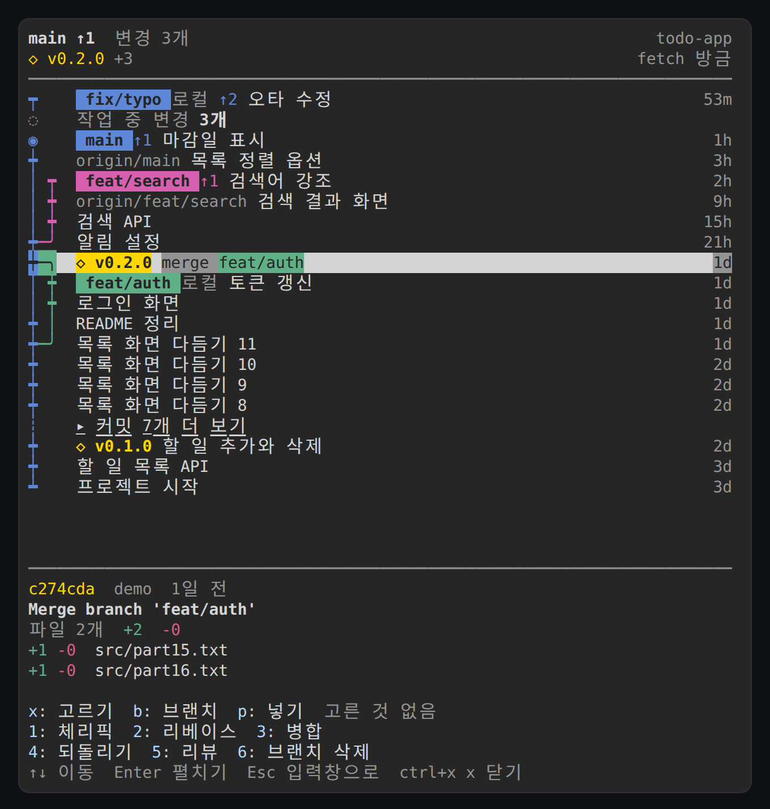

# git-graph

Claude Code 오른쪽에 git 커밋 그래프를 띄워 주는 mod입니다. Claude가 커밋하거나 파일을 고치면 그래프에 바로 나타납니다.



## 설치

```
claude plugin marketplace add altair823/claude-git-graph
claude plugin install git-graph@claude-git-graph
```

git 저장소에서 Claude Code를 열면 오른쪽에 패널이 뜹니다. 터미널이 144칸보다 좁으면 `/git-graph`로 엽니다.

mod를 지원하는 Claude Code(2.1.325 이상)와 git 2.31 이상이 필요합니다.

## 화면

| 표시 | 뜻 |
|---|---|
| `╪` `HEAD` | HEAD(지금 체크아웃한 커밋). 맨 위에 있으면 `╤` |
| `┿` | 커밋. 브랜치 끝은 `┯`, 첫 커밋은 `┷` |
| 흐린 `┯ 작업 중 변경 3개` | 아직 커밋하지 않은 파일 |
| `main ↑1` | push할 커밋 1개. `↓`는 받아 올 커밋 |
| `fix/typo 로컬` | push한 적 없는 브랜치. `↑2`는 어느 원격에도 없는 커밋 수 |
| 흐린 `origin/main` | 로컬과 다른 곳에 있는 원격 브랜치 |
| 흐린 `feat/login 병합됨` | main에 이미 들어 있는 로컬 브랜치. fast-forward로 병합하면 main 줄기 위에 남습니다 |
| `◇ v0.2.0` | 태그. 위쪽 둘째 줄의 `+3`은 그 태그 뒤로 쌓인 커밋 수 |
| `▸ 커밋 7개 더 보기` | 10개가 넘는 직선 구간을 접은 것 |

커서가 커밋에 있으면 아래에 해시, 작성자, 시각, 바뀐 파일이 나옵니다. `◌` 줄에서는 커밋하지 않은 파일 목록이 나옵니다.

## 조작

패널의 줄을 클릭하거나 `ctrl+x tab`을 누르면 들어가고, `Esc`로 나옵니다.

| 키 | 동작 |
|---|---|
| `↑` `↓` | 이동. 맨 위나 맨 아래에서 더 누르면 스크롤 |
| `Enter`, 클릭 | 더 보기 펼치기, 접기 |
| `x` | 커밋 고르기(여러 개 가능) |
| `b` | 그 줄의 브랜치 고르기 |
| `p` | 고른 것을 입력창에 넣기 |
| `1`~`6` | 체리픽, 리베이스, 병합, 되돌리기, 리뷰, 브랜치 삭제를 부탁하는 문장과 함께 넣기 |

입력창에 넣기만 하고 보내지는 않습니다. 문장을 확인하고 직접 보내면 됩니다. 고른 것이 없으면 커서가 있는 줄을 씁니다.

## 업데이트

자동으로 됩니다. 새 버전이 나오면 받아 두었다가 다음 세션부터 씁니다. 바로 쓰려면 패널 위쪽에 나타나는 `u`를 누르면 됩니다.

## 이슈와 PR

버그나 제안은 이슈로 올리면 됩니다.

이 저장소는 비공개 저장소를 그대로 옮겨 오는 미러라서, 여기서 PR을 머지하면 다음 동기화 때 지워집니다. 그래서 PR 내용은 비공개 저장소에 옮겨 반영하고, PR 작성자를 커밋의 공동 작성자로 남긴 뒤 PR을 닫습니다.

## 개발

```
claude plugin validate .
claude plugin test .
```

main에 push하면 CI가 시험을 돌리고, 통과하면 `release` 브랜치에 다음 버전을 올리고 태그를 붙입니다(`scripts/ci-release.sh`). 설치본은 `release` 브랜치만 받습니다.

## 라이선스

MIT
